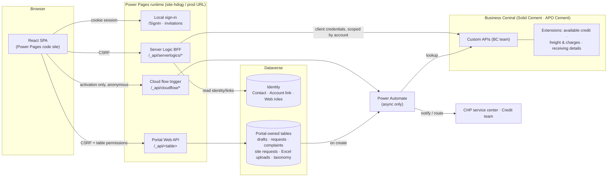
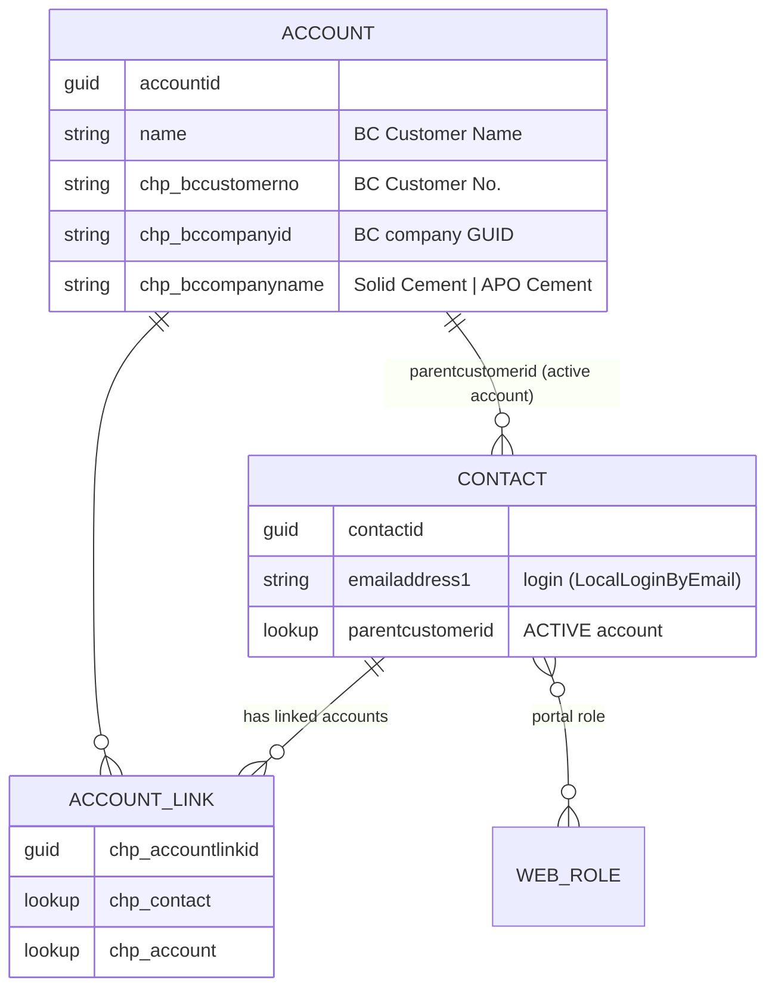
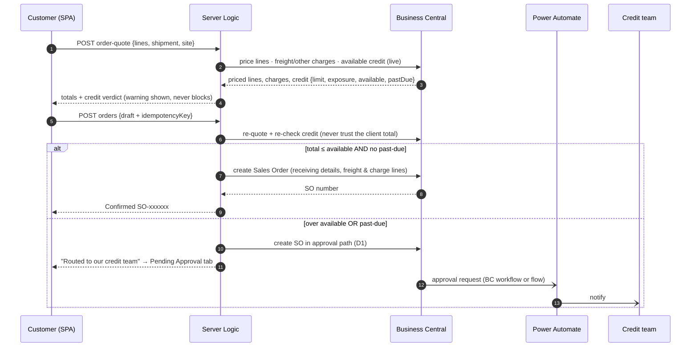

# Concreat Hub — Power Pages Solution Architecture (Release 1)

**Status:** Proposal for team review · **Prepared:** Sept 30, 2026 · **Audience:** PASI Power Platform team, BC Integration team
**Inputs:** Power Platform & BC Developer Packages (Sept 27), monday.com export, `Standard_Portal_Flow_v47_ForDevBuildGuide.html`, BC Postman collection, and the working login/activation POC in this repo.

> INTERNAL — PASI project team only (same classification as the source packages).

---

## 1. Recommendation in one paragraph

Keep **Business Central as the only system of record for business data** and **do not copy BC data into Dataverse**. The React code site calls a thin **Server Logic "backend-for-frontend" (BFF)** layer on the Power Pages runtime. Server Logic calls the BC team's custom APIs **live**, using an app identity (OAuth client credentials). It always scopes each call to the signed-in customer's account, which it resolves on the server, never from browser input. **Dataverse holds only what the portal owns**: identity (Contact ↔ BC customer link, web roles), drafts, and the customer-submitted requests (Requests, Complaints, delivery-site requests, Excel uploads) with their taxonomies. The SPA reads and writes those through the standard **Portal Web API with table permissions**. **Power Automate is reserved for asynchronous back-office work**: the activation email (already built), routing submissions to the service center and Credit team, and notifications. It is never on the read path.

Why this shape fits the requirements:

| Requirement (source) | How the architecture satisfies it |
|---|---|
| Available credit must be **computed live on every request, never cached** (BC pkg) | Server Logic calls the BC Available Credit extension on each check, with no sync layer to go stale |
| Dashboard and Ledger/New Order figures must **never drift** (PP pkg: tie-out item) | One source (BC) and one BFF endpoint per figure. Dashboard and New Order call the same BC endpoint |
| "Nothing recalculated on the portal", pricing comes from BC (PP pkg) | A `order-quote` endpoint returns BC-priced lines, freight and other charges. The SPA only sums for display |
| Filters and export over the **full result set**, not the page (Orders list) | Filtering and paging happen in the BC query (`$filter/$top/$skip`), and export pages through all results on the server |
| Portal access via **native Web Roles / Table Permissions**, no custom user management (wireframe, Rene 2026-09-15) | Four web roles gate both page visibility (UX) and Server Logic and Web API access (enforcement) |
| Multi-account switcher in **Phase 2**, one login per account for Nov 15 | Identity model is designed as Contact → *linked accounts* from day one. Nov 15 ships with exactly one link per contact |

---

## 2. System context



### Layer responsibilities

| Layer | Owns | Never does / never stores |
|---|---|---|
| **React SPA** (code site) | UX, routing, client-side validation, formatting (₱, dates), display sums, Excel export file generation | Hold secrets, call BC directly, decide which customer's data to load, compute prices/credit |
| **Server Logic (BFF)** | Every BC call: auth token, account scoping, OData query building, shaping BC payloads into UI DTOs, server-side re-validation on submit | Store business data, trust `customerNo` from the browser |
| **Portal Web API** | CRUD on portal-owned Dataverse tables under table permissions | Touch BC data |
| **Dataverse** | Identity, account links, web roles, portal-owned submissions, config/taxonomy, announcement | Store copies of BC transactional data (orders, ledger, prices, credit). The only BC values kept are the customer's identity keys (customer no., name, company) on the Account record, written once at activation |
| **Power Automate** | Activation email, routing submissions to the service center/Credit, notifications | Sit on any synchronous read path (too slow; licensing per run) |
| **Business Central** | Customers, ship-tos, items, prices, orders, blanket orders, ledger, documents/PDFs, credit, freight, trip IDs, statuses | — |

**Exception to the Power Automate rule (2026-10-06):** the *Check activation link* flow answers the Set password page on load (valid | invalid). Server Logic would need anonymous read access to `adx_invitation`, which holds secret codes; the flow's one-bit answer about a 128-bit random code reveals nothing useful.

---

## 3. Identity, tenancy and account scoping

This is the most important design point. Every BC call is scoped to one BC customer in one BC company, and that scope comes **only** from the server session.

### Data model



- **Dataverse Account = identity mirror of a BC customer**, holding only key fields (name, customer no., company). It holds no balances, addresses or terms. Those are always read live from BC.
- **`Contact.parentcustomerid` = the active account.** This gives **Account-scoped table permissions for free**: every contact of the same customer sees the same Requests, Complaints and site requests, with no custom code.
- **`Account Link` table (Contact ↔ Account, N:N)** is created now with one row per contact. Phase 2's switcher just adds rows (fed by the BC linked-accounts extension). Switching accounts then means a Server Logic call that validates that the target account is in the contact's links and updates `parentcustomerid`. Table permissions and every BFF call follow automatically, with no re-authentication, which matches the Phase 2 acceptance criteria.

### Scoping rule (non-negotiable)

Every Server Logic function starts the same way:

1. `Server.User` → contact id (null means reject).
2. Read the contact's active Account (`chp_bccustomerno`, `chp_bccompanyid`).
3. Build the BC URL with that company and that customer filter. Any `customerNo`/`companyId` in the request is **ignored**.
4. For detail calls (`?id=SO-…`), verify that the BC record's `sellToCustomerNo` equals the session customer before returning it.
5. Escape every user-supplied value placed in an OData `$filter` (single-quote doubling, as the activation flow already does).

### Activation (POC → production)

The POC flow already does BC lookup → Contact → single-use invitation → email, and it works end to end. Production changes:

- Query the **BC team's customer/contact API** instead of the standard `v2.0/customers`. The BC package's match rule is "Customer whose registered Contact has this email". **Company scope: Solid Cement only for now** (decision Oct 1, 2026); APO Cement is added later by configuration (plan task S1-12). An email that matches more than one customer follows rule **Q10** (Registration doc §7).
- Find or create the **Account** (by `chp_bccustomerno` + company), set `parentcustomerid`, and create the Account Link row.
- **Role on activation (decision D4):** activation grants no business role by default. CHP ops assigns one of the four roles in Portal Management, per the "no in-portal user management" direction. Alternative: auto-grant `Full Access` when the email is the BC customer card's primary email.

---

## 4. Security model

### Web roles (from the wireframe's `PORTAL_ROLE_PAGES`)

| Web role | Dashboard | Orders | Delivery Sites | Customer Ledger | Document Center | Requests | Complaints & Feedback | Account & User Mgmt |
|---|---|---|---|---|---|---|---|---|
| **Full Access** | ✓ | ✓ | ✓ | ✓ | ✓ | ✓ | ✓ | ✓ (+ revoke access) |
| **Orders & Delivery** | ✓ | ✓ | ✓ | – | – | ✓ | – | view* |
| **Finance & Documents** | ✓ | – | – | ✓ | ✓ | – | – | view* |
| **View Only** | ✓ | – | – | – | – | – | – | view* |

\*The wireframe's role map doesn't list Account & User Management. The assumption above is read-only Company info for all roles, and **revoke access** for Full Access only. Confirm this with Rene (open question Q6).

Enforcement happens in three places. Only the last two are security; the first is UX:

1. **SPA** hides nav items and routes by role (UX only).
2. **Server Logic records** are assigned to the web roles in the matrix. A Finance user calling `/_api/serverlogics/orders` gets 403 from the runtime.
3. **Table permissions** on portal-owned tables, mostly **Account scope** through `parentcustomerid`, plus role-specific create/read.

### Secrets and BC access

- BC access goes through an **Entra app registration** (client credentials), registered **inside BC** with a permission set limited to the Concreat Hub API pages (read, plus Sales Order create). Do not reuse the "Monday CRM" app.
- Client secret: **Azure Key Vault → Dataverse environment variable (secret type) → site setting**, read with `Server.SiteSetting`. Non-secret config (BC tenant, environment name, company IDs, API base path) goes in plain environment variables, so it differs per environment without code changes.
- Tenant admins can **disable external calls from Server Logic** (a GA governance control). This must stay enabled for Concreat Hub's environment.
- **Dev exception (2026-10-04):** the BC client secret is a plain-text environment variable with no default value, set by hand in Dev only. Key Vault is required before UAT (plan task S1-14).

---

## 5. Module data map

| Module / feature | Read from | Write to | Mechanism |
|---|---|---|---|
| **Sign-in / Activation** | Dataverse (Contact), BC (email match) | Dataverse (Contact, Account, Link, Invitation) | Power Pages local auth + activation cloud flow (built in POC) |
| **Dashboard — greeting** | Session (`Server.User`) + Account | – | `me` |
| **Dashboard — credit tiles** (Credit limit, Available credit) | BC Available Credit ext | – | `dashboard` (same call New Order uses) |
| **Dashboard — Balance / Balance due / Overdue** | BC customer ledger | – | `dashboard` |
| **Dashboard — Sales statistics tiles** (5 counts) | BC Sales Orders (+ archive) | – | `dashboard` (BC-side count endpoint preferred) |
| **Dashboard — Announcement** | Dataverse `chp_announcement` (newest active row, set by the account team in Concreat Connect Admin) | – | `announcement` Server Logic, read live with `skipCache` (decided 2026-10-09: the Web API served this Global-read table from a shared cache for up to 15 min) |
| **Orders list / filters / paging / export** | BC Sales Orders + archive (status mapping below) | – | `orders` GET (server-side filter/page; `all=true` for export) |
| **Order view / Reorder / Trip ID** | BC SO + lines + Trip ID field | – | `orders` GET `?id=` |
| **Blanket Orders tab / Blanket entry** | BC Blanket Sales Orders + schedule | BC Sales Order referencing Blanket SO # | `blanket-orders`, `orders` POST |
| **New Order — options** (items, UOM, customer prices, plants/Source, ship-tos, payment method/terms) | BC | – | `order-options` |
| **New Order — quote** (priced lines, freight ₱3,500/₱0, other charges, credit check) | BC price calc + freight ext + credit ext | – | `order-quote` POST |
| **New Order — submit** | – | BC Sales Order incl. receiving details, freight/other-charge lines | `orders` POST (re-quotes + re-checks credit server-side) |
| **Pending Approval tab** | BC (SOs pending credit approval + reason) | – | `orders?view=pending` (see decision D1) |
| **Drafts tab** | Dataverse `Order Draft` (JSON payload) | Dataverse | Web API (Contact scope) |
| **+ New Multiple Order (Excel)** | – | Dataverse `Excel Order Upload` (file + notes) | Web API → flow notifies service center |
| **Customer Ledger** | BC Customer Ledger Entries | – | `ledger` |
| **Document Center list / search / download** | BC posted invoices, credit memos, posted whse. shipments (Delivery Receipt), payments (Acknowledgement Receipt) + PDFs | – | `documents`, `document-file` (base64 JSON) |
| **Delivery Sites list** | BC Ship-to Addresses | – | `sites` |
| **Delivery Sites — request new / change / removal + pending list** | Dataverse `Site Request` | Dataverse | Web API (Account scope) → flow to service center. CHP applies the change in BC |
| **Requests (6 of 11 categories)** | Dataverse `Request` + taxonomy tables | Dataverse | Web API (Account scope) → flow routes to Assigned Group |
| **Complaints tab** (+ attachments, consent) | Dataverse `Complaint` + taxonomy | Dataverse | Web API (Account scope) → flow routes to Assigned Group |
| **Account & User Mgmt — company info** | BC customer card | – | `company` |
| **Account & User Mgmt — contacts & access** | BC contacts for the customer, merged with Dataverse portal contacts and web roles | Dataverse (revoke) | `company` GET; `portal-access` POST (Full Access only) |
| **In-portal help** | Static content in the SPA | – | – |

**Order status mapping** (confirmed with PASI's BC consultants on 2026-09-14, per the wireframe): BC *Open* → Open · BC *Pending Prepayment* → Pending Prepayment · BC *Released* → Ready for Dispatch · archived with *Completely Shipped = Yes* → Completely Shipped · archived with *Completely Shipped + Invoiced* → Invoiced. The BC API must therefore cover **archived** Sales Orders, not only open ones (see §7).

---

## 6. Server Logic API surface (BFF)

One Server Logic record per resource. Function names follow the HTTP verb. Server Logic can't `require`/`import`, so each record carries a small copy of the shared helpers (token, BC GET/POST, OData escaping, scoping). Keep those helpers byte-identical across files and generate them from one template in the repo.

| Endpoint (`/_api/serverlogics/…`) | Verb | Roles | Returns / does |
|---|---|---|---|
| `me` | GET | all | Contact name, active account (customer no/name, company), roles. Phase 2: linked accounts |
| `announcement` | GET | all | Newest active Dashboard announcement `{ title, message }` or `null`, read live (`skipCache`) |
| `dashboard` | GET | all | Credit (limit, exposure, available), ledger tiles, SO status counts. **One call, fanned out server-side** |
| `orders` | GET | Full, Orders&Delivery | List with `q, status, site, from, to, page` (10/page) · `?id=` detail · `?view=pending` · `?all=true` for export |
| `orders` | POST | Full, Orders&Delivery | Submit: re-quote → re-check credit → create BC SO (or approval path). Requires an **idempotency key** from the client |
| `order-options` | GET | Full, Orders&Delivery | Items/UOM/customer price, plants (plain labels), ship-tos, payment method + terms, standard freight |
| `order-quote` | POST | Full, Orders&Delivery | BC-priced lines, freight, other charges, totals, credit verdict + message |
| `blanket-orders` | GET | Full, Orders&Delivery | Blanket SOs + schedule + remaining quantities |
| `ledger` | GET | Full, Finance | Entries with date range / type / reference search, paged |
| `documents` | GET | Full, Finance | Document list with type filter + search |
| `document-file` | GET | Full, Finance | `{ fileName, contentType, base64 }` (HttpClient bodies are strings, so BC must return PDFs as base64 JSON) |
| `sites` | GET | Full, Orders&Delivery | Ship-to list (code, address, contact, phone, default) |
| `company` | GET | all | Company info + contacts with portal-access flag and role |
| `portal-access` | POST | Full | Revoke a same-account contact's portal access (never self) |
| `switch-account` | POST | all | **Phase 2**: validate the link and set `parentcustomerid` |

**Performance notes**
- Each call gets a BC token and then calls BC. That's two outbound hops, typically a few hundred ms each. Aggregate where a screen needs several figures (`dashboard`, `order-options`) and run BC calls in parallel (`Promise.all`) inside the function.
- Client side, use **TanStack Query** for dedupe, caching and background refresh (e.g., `sites` and `order-options` cached for minutes). Credit and quote queries use `staleTime: 0`, because the BC package requires live figures.
- Export to Excel: `orders?all=true` pages through BC on the server. The SPA builds the `.xlsx` (SheetJS), so the export is exactly the filtered set the user sees.

---

## 7. Order submission and credit flow



**Decision D1: where does a "pending credit approval" order live?**
- **Recommended: in BC**, as a Sales Order held by **BC's approval workflow** (or a BC-extension status) carrying the reason (*exceeds available credit* / *past-due balance*). The Credit team already works in BC, the portal's Pending Approval tab is just a filtered BC read, and "auto-approved confirmation once cleared" means BC releasing it. It is a single source of truth, with no two-phase commit between Dataverse and BC.
- Alternative: a Dataverse `Order Submission` staging row, plus a flow that creates the BC SO after Credit approves. This is simpler on the BC side, but it creates a second order store and a sync failure mode.

---

## 8. What we need from the BC team (API contract)

The shared Postman collection is a **reused "Monday CRM Integration – DEV" collection** (`api/pasi/mcrm/v1.0`). Several request bodies come from unrelated projects (airline/hotel fields), and it includes a `cemex/plantscan` API. It proves the auth pattern and the publisher/group style, but it is **not yet a Concreat Hub contract**.

> ⚠️ The collection's *Get Token* request contains a **hardcoded client secret**. Treat it as exposed: ask the BC team to **rotate it**, keep the file out of git (it's currently untracked in `docs/`), and use a Postman environment/secret variable instead.

| Needed by portal | In collection? | Ask |
|---|---|---|
| Customer by email (Solid Cement now; APO Cement later) + credit limit, payment method, prepayment/payment terms, VAT reg no., website, address | Partly (`mcrmCustomers`, `MCRMContacts`) | Filterable by contact email; include the listed fields |
| Contacts of a customer (name, title, phone, email) | Partly (`MCRMContacts`) | Filter by customer no. |
| Ship-to addresses (code, address, contact, phone, default) | Yes (`mcrmShipToAddress`) | Filter by customer no.; **default** flag |
| Items for ordering + **customer-specific price per UOM (BC-calculated)** | Items yes; prices only as raw price lists | A price-calculation endpoint so the portal never evaluates price lists itself |
| Plants / locations for "Source" (customer-facing label) | No | Location list with a customer-facing name |
| Sales Orders **incl. archived**, lines, status, PO ref (External Doc No.), ship-to, shipment method, Trip ID + assigned date, expected delivery, Blanket SO # | Partly (`mcrmSalesOrders`) | Status per the mapping in §5, filterable and pageable, plus archive coverage |
| SO counts by status (Dashboard) | No | Count endpoint (avoid pulling all orders to count them) |
| Create Sales Order with receiving details, loading type, call-before-delivery, instructions, time window, freight & other-charge lines | Create yes; new fields no | Depends on the **Receiving-details** and **Freight & Other Charges** extensions |
| **Available credit** (limit, exposure, available, past-due flag), live | No | **Available Credit** extension as an API |
| Freight rate + other charges for a draft order | No | Quote-style endpoint (no SO created) |
| Pending-approval orders + reason; approval outcome | No | Decision D1 |
| Blanket Sales Orders + schedule + remaining qty | No | New API |
| Customer Ledger Entries (doc no, type, ext. doc no, posting/due date, original/remaining, open/closed) + balance/balance due/overdue | No | New API (these are standard BC fields) |
| Posted invoices, credit memos, posted whse. shipments, payments + **PDF as base64** | No | New API; PDFs via BC report engine |
| Phase 2: linked accounts for an email (company, customerNo, customerName, address, website, vatRegNumber) | No | Linked-accounts extension (Phase 2) |

**Contract conventions to agree up front:** one API publisher/group/version for Concreat Hub (e.g. `api/pasi/concreathub/v1.0`); camelCase fields; `$filter`, `$top`, `$skip`, `$count` support on list endpoints; company addressed by `companies({id})`; an OpenAPI or Postman collection **per environment** (sandbox and prod) with no secrets inside.

---

## 9. Dataverse data model (portal-owned)

Publisher **Concreat Holdings**, prefix `chp_`, solution `ConcreatHub` (created in Dev on 2026-10-01, S0-07).

| Table | Key columns | Table permission |
|---|---|---|
| Account *(standard)* | `chp_bccustomerno`, `chp_bccompanyid`, `chp_bccompanyname` | read: Self/Account via contact (for `me`) |
| Contact *(standard)* | `parentcustomerid` = active account | Self read |
| `chp_accountlink` | contact, account | Contact scope read (Phase 2 picker) |
| `chp_orderdraft` | contact, account, name, `chp_payload` (JSON), modified | **Contact** scope CRUD (drafts are personal) |
| `chp_excelorderupload` | account, contact, file, notes, status | Account scope create/read |
| `chp_siterequest` | account, type (new/change/remove), ship-to code, address, city/province, contact 1–3, email, landmark, shipment method, status | Account scope create/read |
| `chp_request` | account, submitted by, category, request type, assigned group, contact method/value/person, details, category fields, status, attachments | Account scope create/read |
| `chp_complaint` | account, submitted by, category, complaint type, assigned group, incident date, delivery site, SO no., subject, description, consent, attachments, status | Account scope create/read |
| `chp_requesttype` / `chp_complainttype` | category, type, assigned group, active, field config | Global read (ops edit in model-driven app, no redeploy) |
| `chp_announcement` | title, message, active | Global read |

Requests and Complaints reference BC data (SO no., ship-to code) as **plain text keys**, not lookups, because the BC data isn't in Dataverse.

---

## 10. Front-end structure (React code site)

Grow the POC in place (it already has local auth, activation, Tailwind, Lucide and the design tokens):

```
src/
  api/            serverLogic.ts (one CSRF-aware caller) · webApi.ts · types.ts (DTOs per endpoint)
  auth/           auth.ts (from POC) · useMe() · RequireRole (UX-only guard)
  layout/         AppShell (topbar + logo, nav with active highlight, help link)
  modules/
    dashboard/  orders/  sites/  ledger/  documents/  requests/  complaints/  account/
  ui/             Table, Pagination, Filters, StatusPill, Money, Modal, EmptyState …
  lib/            format (peso, dates), excel export (SheetJS, lazy-loaded)
```

- **Build to the wireframe**: same fields, labels, dropdown values and copy (per the packages, "replicate it, don't redesign it"). The wireframe's sample arrays (`ORDERS`, `SITES`, `CATALOG`…) become the **DTO shapes** returned by the BFF, which keeps the two teams aligned.
- Route-level code splitting per module (`React.lazy`). SheetJS loads only on export.
- Local dev uses **mock DTO fixtures** built from the wireframe's sample data behind the same `api/` functions, which is the same pattern the POC's auth mock uses. The SPA team isn't blocked while BC APIs are in progress.

---

## 11. Environments and ALM

| | Dev | Test/UAT | Prod |
|---|---|---|---|
| Power Platform env | Development Test - MT (current) | TBD | TBD |
| BC environment | SANDBOXUS (current POC) or a Concreat sandbox | Concreat sandbox | Concreat production |
| BC companies | env var per company: **Solid Cement** now; APO Cement added later | same | same |

- One **solution** containing the site, tables, flows, Server Logic, environment-variable definitions and connection references, promoted with **Power Platform Pipelines** (`/plan-alm`, `/setup-pipeline`).
- All BC coordinates (tenant, env name, company IDs, API path) are **environment variables**. Secrets live in Key Vault references.
- Cloud flows must be **re-registered** in each target environment (Power Pages ALM requirement).
- Site visibility stays **private** until go-live (Q7).

---

## 12. Alternatives considered

| Option | Why not (for Release 1) |
|---|---|
| **BC virtual tables in Dataverse + Portal Web API** ("Power Pages on virtual tables") | Still **preview**. Authenticated external access is limited to customers of the BC company set in the virtual-table global settings, which clashes with two companies and the Phase 2 cross-company switcher. It also depends on BC API pages being virtualizable. Revisit when GA |
| **Sync BC → Dataverse** (flows/dual-write) and read via Web API | Violates "live credit, never cached" and the Dashboard↔Ledger tie-out. Adds sync jobs, conflict handling, storage and staleness for no user benefit |
| **Power Automate for reads** | Several seconds per call and per-run licensing. Fine for the async activation/routing jobs it already does |
| **Azure Functions / APIM as the BFF** | Viable and more scalable, but adds Azure hosting, deployment and cost. Server Logic (GA Apr 2026) covers the need inside the platform, with web-role enforcement built in |

---

## 13. Decisions and open questions

| # | Decision / question | Recommendation | Owner |
|---|---|---|---|
| D1 | Where pending-credit-approval orders live | BC approval workflow (§7) | BC team + PASI |
| D2 | Customer-specific pricing source | BC price-calculation endpoint, not raw price lists | BC team |
| D3 | Where Requests/Complaints/site requests are worked by CHP ("internal service-center system", never named in the wireframe) | Dataverse tables + flow notification. If CHP runs **Dynamics 365 Customer Service**, create Cases instead | CHP / Rene |
| D4 | Role granted on activation | None; ops assigns a role in Portal Management | Rene |
| Q5 | BC API exposure of archived SOs, posted docs + PDFs, ledger | Needed for Orders statuses, Document Center, Ledger (§8) | BC team |
| Q6 | Account & User Mgmt visibility per role (missing from role map) | All roles read; Full Access revokes | Rene |
| Q7 | Go-live URL, custom domain, site visibility → Public | Needed before external UAT | CHP IT |
| Q8 | Email sender for activation/notifications | Shared mailbox (e.g. `noreply@…`) with Send As | CHP IT |
| Q10 | Email registered on more than one BC customer (within Solid Cement now, across companies later) | Block activation and route to the service center (Registration doc §7) | Rene + BC team |
| Q11 | When APO Cement goes live on the portal | Start with **Solid Cement only** (decided Oct 1, 2026); APO via plan task S1-12 | Rene |
| Q9 | BC API service limits for expected concurrency | Load-test `dashboard` and `orders` against the BC sandbox early | BC team |

---

## 14. Suggested build order toward Nov 15

The packages flag the Nov 15 scope as *proposed, pending capacity confirmation*. Sequencing by dependency reduces risk whatever the final scope:

1. **Foundation (week 1–2):** identity model (Account, Link, roles), activation on the BC team's API, AppShell/nav/logo/help, `me` endpoint, BFF helper template + Key Vault secret, mock fixtures. *Unblocks every module.*
2. **Read-only BC (week 2–4):** Delivery Sites → Orders list/view/Trip ID → Dashboard (credit, ledger tiles, stats) → Customer Ledger → Document Center (list, then PDF). *Each depends only on a BC read API.*
3. **New Order (week 3–6):** options → quote → submit (Single) → Drafts → Pending Approval → Excel upload → Export → Blanket. *Depends on BC extensions (credit, freight, receiving) and D1/D2.*
4. **Portal-owned submissions (week 4–6, parallel):** Requests (6 categories), Complaints tab, site requests, revoke access. *Dataverse-only, so they can proceed independently of BC.*
5. **Hardening (week 6–7):** role/permission audit (`/audit-permissions`), security scan, load test against BC, accessibility, UAT.

Phase 2 (after Jan 1, 2027): linked-accounts extension → `switch-account` + picker UI; remaining Requests categories; Survey/Commendation tabs; step-by-step help guides.
