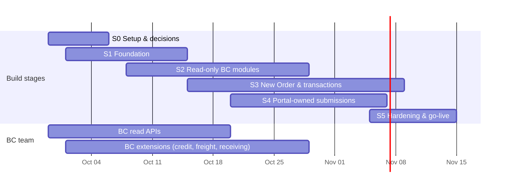

# Concreat Hub — Implementation Plan (Release 1)

**Based on:** `Concreat_Hub_Architecture.md` (Sept 30, 2026) · **Registration design:** `Concreat_Hub_Registration_Architecture.md`
**Target:** Full portal by **Nov 15, 2026** (PROPOSED, pending capacity confirmation) · Account switcher and feature completion **after Jan 1, 2027**.

> INTERNAL — PASI project team only.

## How to read this

- **Stages S0–S5** are *build stages* toward Nov 15. The client's **"Phase 2"** (after Jan 1, 2027) keeps its name and is listed separately at the end, to avoid mixing up the two.
- **Owner:** **PP** = Power Platform team · **BC** = BC Integration team · **CHP** = Concreat Holdings · **PM** = PASI project lead.
- **monday** = the matching item on the "Concreat Holdings — Customer Portal" board (✚ = new technical task not on the board).
- **Done when** is the acceptance check. A task isn't done until it passes against the **BC sandbox**, not mock data (except S1 mock fixtures).
- Week numbers are indicative, from the Sept 29 start: W1 = Sept 29, W7 = Nov 10.
- **Status:** ✅ Done · 🟡 In progress · ⛔ Blocked · ⬜ Not started · ⏸ Skipped/Deferred. Update the Status and Notes columns as tasks move. Last updated **2026-10-04**.

**Critical path:** BC sandbox + app registration (S0) → BC read APIs → S2 → BC extensions → S3 New Order submit. Portal-owned modules (S4) don't depend on BC and can absorb slack.

---

## S0 — Setup, access and decisions (W1)

| ID | Task | Owner | Depends on | Done when | monday | Status | Notes |
|---|---|---|---|---|---|---|---|
| S0-01 | Create the new project folder/repo; move in the architecture, registration and plan docs; keep the BC Postman file **out of git** (`.gitignore`) | PP | – | Repo builds; docs in `docs/`; no secrets tracked | ✚ | ✅ Done | Repo scaffolded (commit fb2023b) |
| S0-02 | Request a **Concreat BC sandbox** (production copy) with the **Solid Cement** company (APO Cement deferred, see S1-12); a separate UAT sandbox | PM → BC | – | Environment name + Solid Cement company ID received | ✚ | ✅ Done (Dev) | BC env `TRAINING`, Solid Cement company ID received (2026-10-01); env renamed to `DEV` and new company ID d2e4496e… (2026-10-04). UAT sandbox still to request |
| S0-03 | **Entra app registration** for the portal, registered in BC with a Concreat Hub–only permission set; **rotate** the secret exposed in the Postman collection | BC | S0-02 | Client ID given; secret in Key Vault (never in chat or a file) | ✚ | ✅ Done (Dev) | BC team gave client ID + secret (2026-10-04); client credentials work from Server Logic and flows (company endpoint, activation). Dev exception: secret is a plain-text env var `chp_BCClientSecret` (Key Vault moves to S1-14). Still asked of BC: rotate the secret exposed in the Postman collection; confirm a portal-only permission set |
| S0-04 | **Test customers** with team-controlled emails covering: cash, terms, over-limit, past-due, multi ship-to, blanket SO, every SO status, Trip IDs, ledger + posted docs | BC | S0-02 | Test data list shared with IDs | ✚ | 🟡 In progress | 6 candidate customers found in TRAINING; gaps raised (unique emails, SO status, credit/ledger). Activation/auth tests use C00000009 BESTRADE and BORLAND contacts (DEV, 2026-10-07); order/ledger test data still needed for S2+ |
| S0-05 | Agree the **API contract**: publisher/group/version, camelCase, `$filter/$top/$skip/$count`, OpenAPI or Postman **per environment, no secrets** | PM + BC + PP | – | Contract doc signed off (Architecture §8 list) | ✚ | 🟡 In progress | Dev temporarily uses `/api/pasi/mcrm/v1.0` (Monday APIs); portal contract not agreed |
| S0-06 | Decisions **D1** (pending-approval orders in BC workflow), **D2** (BC price calculation endpoint), **D3** (service-center system: Dataverse vs D365 Customer Service), **D4** (role on activation), **Q10** (email registered on more than one BC customer: block / first match / primary; Registration doc §7) | PM + CHP + BC | – | Decisions recorded in the architecture doc | ✚ | ⬜ Not started |  |
| S0-07 | Power Platform environments (Dev/UAT/Prod), **solution + publisher prefix**, Key Vault, environment-variable definitions (BC tenant, env, company IDs, API path, site URL, sender mailbox) | PP | S0-02 | Solution exists in Dev with env vars | ✚ | ✅ Done (Dev) | Publisher `chp_`, solution `ConcreatHub`, 9 env vars all set (adds chp_BCClientId, chp_BCClientSecret, chp_PowerPagesSiteId; sender mailbox = developer's in Dev), linked to `BC/*` site settings. UAT/Prod + Key Vault later (S1-14) |
| S0-08 | ALM: **Power Platform Pipeline** Dev → UAT → Prod (`/plan-alm`, `/setup-pipeline`) | PP | S0-07 | Empty solution deploys to UAT | ✚ | ⏸ Skipped | Single Dev environment for now |
| S0-09 | Confirm Server Logic **external calls are allowed** for the environment (admin governance setting) | PP + CHP IT | S0-07 | Test Server Logic can call an external URL | ✚ | ✅ Done (Dev) | Verified 2026-10-05: the `company` Server Logic calls login.microsoftonline.com and BC from Dev. Re-check per environment |

---

## S1 — Foundation (W1–W3)

Unblocks every module. Nothing module-specific ships here.

| ID | Task | Owner | Depends on | Done when | monday | Status | Notes |
|---|---|---|---|---|---|---|---|
| S1-01 | Scaffold the code site in the new repo from the POC (React/Vite/Tailwind/Lucide, theme tokens, auth pages); deploy + activate the new site | PP | S0-07 | Site live (private) in Dev | ✚ | ✅ Done (Dev) | Deployed + activated 2026-10-01, private: https://chp-portal-dev.powerappsportals.com |
| S1-02 | **Identity model**: Account columns `chp_bccustomerno`, `chp_bccompanyid`, `chp_bccompanyname`; table `chp_accountlink`; Contact `parentcustomerid` = active account | PP | S0-07 | Tables in the solution; sample data created | ✚ | ✅ Done (Dev) | Account BC columns + key chp_bccustomer, chp_accountlink, chp_accessgrant via scripts/dataverse/identity_schema.py (ConcreatHub). Test data via seed_dev_test_users.py: account 10482 + full@/orders@/finance@/viewonly@/norole@example.com (2026-10-04) |
| S1-03 | **Port activation flow** into the solution: BC team's customer/contact API, **Solid Cement only** (company ID from an env var), find/create Account + Link, duplicate-email rule per Q10 (`$top 2`), env-var site URL + shared mailbox, skip blocked customers (see Registration doc §6–7) | PP | S1-02, S0-03, S0-05, S0-06 (Q10) | A Solid Cement test customer activates, signs in, and has Account + Link rows; a duplicate-email test gets no invitation | ✚ | ✅ Done (Dev) | Also (2026-10-04): reuse an existing Contact by email (case-insensitive), never create a duplicate; link a pre-created Contact to its Account; apply a matching `chp_accessgrant` (S1-13) on activation Done 2026-10-07 (sub-projects C + D): flow "Concreat Connect – Request activation" (statuses ok / needs_help / already_active, customerPortalAccess = true only, cancels older links, 24 h links, email in link, marks email confirmed); "Check activation link" flow (anonymous, expired card on open); forgot password with the "Send password reset" flow. All live checks passed — see docs/presentation/authentication-testing-guide.md. |
| S1-04 | Auth site settings + Code-Site-Shell-Header template (from POC) | PP | S1-01 | Invitation-only registration works; `/SignIn` redirects to `/` | ✚ | ✅ Done (Dev) | Invitation-only: OpenRegistration off, RequiresInvitation on, LocalLoginByEmail on, Entra/external login off (private-site gate still works). Code-Site-Shell-Header redirects verified: /SignIn → /, /register → /activate, no-code /Account/Login/Register → 404 |
| S1-05 | **Web roles**: Full Access, Orders & Delivery, Finance & Documents, View Only; role assignment runbook for CHP ops (Portal Management) | PP | S0-06 (D4) | Roles deployed; runbook written | ✚ | ✅ Done (Dev) | 4 web roles deployed; least-privilege table permissions (Contact Self read, Account via contact_customer_accounts read). Runbook: docs/runbooks/portal-access.md |
| S1-06 | **Server Logic helper template**: BC token (client credentials), BC GET/POST, OData escaping, session → account scoping, error envelope; generated into each endpoint | PP | S0-03, S0-09 | Unit-style test endpoint returns sandbox data only for the caller's customer | ✚ | ✅ Done (Dev) | Done 2026-10-06: server-logic-src/bc-helpers.js stamped into company + me (drift test); client-credentials token (JSON body), OData escaping, session scoping, live BC customerPortalAccess check (blocked → {"blocked":true}), redacted step-named errors. company returns the session customer's BC card on Dev. |
| S1-07 | `me` endpoint: contact name, active account, company, roles | PP | S1-02, S1-06 | Returns the correct account; rejects anonymous callers | ✚ | ✅ Done (Dev) | `me` verified per role on Dev. Runtime facts: envelope is camelCase {success,data,error}; Server.User.Roles arrives as text "System.String[]" so roles are read via powerpagecomponent_mspp_webrole_contact; validator rejects anonymous function expressions (RTSL01). Anonymous call → 403 Update 2026-10-06: me checks BC portal access (blocked: true → "Your access has been turned off"). |
| S1-08 | SPA foundation: `api/serverLogic.ts` (CSRF caller), TanStack Query, `useMe()`, role-based nav/route guard (UX only), mock DTO fixtures from wireframe sample data | PP | S1-07 | Each module can develop against mocks with the same `api/` functions | ✚ | ✅ Done (Dev) | Sub-project A (2026-10-04): `serverLogic.ts` with dev-server mocks, `useMe()`, UX route guard, `me` fixtures per role (full@/orders@/finance@/viewonly@/norole@test.ph). Each module adds its own DTO + fixture. Deployed check after S1-07 |
| S1-09 | **AppShell**: topbar with Concreat logo on every page, nav in the agreed order + rename, active folder highlighting, full-width section captions | PP | S1-08 | Matches the wireframe on all 8 sections | Navigation — logo / folder order & rename / active highlighting / full-width text | ✅ Done (Dev) | AppShell: logo, nav in package order + rename, active highlight, full-width captions (`PageHeader`). Sections are placeholders until S2+ |
| S1-10 | **In-portal help (basic)**: 8 one-paragraph overviews + help link on every page | PP | S1-09 | All 8 blurbs reachable | Navigation — In-portal help | ✅ Done (Dev) | Help dialog with the 8 wireframe overviews, reachable from every page |
| S1-11 | Text, wordings and naming conventions (renames applied as screens are built) | PP | S1-09 | Checklist of renames verified at S5 | Navigation — Text, wordings & naming | 🟡 In progress | Checklist started: `docs/wording-checklist.md`. Renames continue as screens are built |
| S1-12 | **Deferred: enable APO Cement.** BC sandbox company + test customers; add the APO company ID env var; activation searches both companies with the Q10 rule; regression-test every module with an APO customer. Schedule once CHP confirms the APO go-live date | PP + BC | Confirmation from Rene; S1-03 | An APO Cement test customer activates and sees only APO data | ✚ | ⬜ Not started |  |
| S1-13 | **Access grants (internal admin)**: table `chp_accessgrant` (email, BC customer no., web role, note) + model-driven app *Concreat Connect Admin* for CHP staff (work sign-in, Dataverse security role); flow on grant create/update adds the web role to an already-activated Contact whose Account matches the customer no. Activation applies grants (S1-03) | PP | S1-02, S1-05 | A grant made before or after activation gives that contact the role; a grant whose customer no. doesn't match the contact's account does nothing | ✚ | ✅ Done (Dev) | Concreat Connect Admin app + security role; flow "Concreat Connect – Apply access grant" (workflow 90ab6842…, scripts/dataverse/grant_flow.{json,py}). Verified Applied / Customer mismatch / Pending. Before UAT: move the hardcoded Dev site id into an env var. Rene to confirm the internal admin app (D4); CHP staff need Power Apps licences |
| S1-14 | **UAT readiness for S1 identity/grants**: before go-live, protect the anonymous Activate and Forgot password pages: enable the Power Pages WAF on the production site with a per-IP rate limit plus JavaScript challenge (escalating to CAPTCHA) on the activation flow trigger and /Account/Login/ForgotPassword; optionally reCAPTCHA on both forms with the token verified server-side (site key + secret as env vars). A 10-minute activation cooldown is already in the flow (2026-10-07); move chp_BCClientSecret to a Key Vault-backed secret environment variable; rebind the chp_outlook connection reference (activation, password reset) to a service mailbox connection; register the Check activation link flow per environment and build with that environment's flow ids; the owner of portal contacts (the user Power Pages' password-reset email is sent "from") must allow sending on their behalf (Personal options → Email; usersettings.issendasallowed); env var `chp_PowerPagesSiteId` read by the grant flow and `me` role filter (no hardcoded Dev site id); grant-flow connection reference bound to a service-account connection (not a developer's); `grant_flow.py` looks up the solution by unique name; filter `me` roles to this site | PP | S1-13, S0-08 | The flow and `me` run unchanged in UAT after solution import + env var values | ✚ | ⬜ Not started | From the sub-project B final review (2026-10-04) |

---

## S2 — Read-only BC modules (W2–W5)

Each item needs one BC read API (BC column) plus a PP endpoint and a PP screen.

| ID | Task | Owner | Depends on | Done when | monday | Status | Notes |
|---|---|---|---|---|---|---|---|
| S2-01 | BC API: **Ship-to addresses** by customer (incl. default flag) | BC | S0-05 | Available in sandbox | – | 🟡 In progress | `mcrmShipToAddress` exists; no default flag; shipment method blank |
| S2-02 | `sites` endpoint + **Delivery Sites list** (columns, search, default flag) | PP | S2-01, S1-09 | Matches wireframe; only the caller's ship-tos | Delivery Sites — Registered sites list | ⬜ Not started |  |
| S2-03 | BC API: **Sales Orders incl. archived**, lines, status mapping, PO ref, ship-to, shipment method, Trip ID + assigned date, expected delivery, Blanket SO # | BC | S0-05 | All 5 portal statuses representable | – | 🟡 In progress | `mcrmSalesOrders` + `chpSalesOrderLines` exist; missing status, archived SOs, document type, shipment method |
| S2-04 | `orders` GET (filters, 10/page, detail by id with ownership check) | PP | S2-03, S1-06 | Filters run in BC over the full set; another customer's SO → 404 | ✚ | ⬜ Not started |  |
| S2-05 | **Orders list**: search, status/site/date filters, clear, pagination, status pills, full-width caption fix | PP | S2-04 | Matches wireframe | Orders List — filters, search, status, pagination · full-width caption fix | ⬜ Not started |  |
| S2-06 | **Order view** + **Trip ID** ready/pending states (Pick up vs Delivery copy) + Reorder | PP | S2-04 | All Trip ID states render with the specified copy | Trip ID display | ⬜ Not started |  |
| S2-07 | BC API: **Customer Ledger Entries** + balance / balance due / overdue | BC | S0-05 | Available in sandbox | – | ⬜ Not started |  |
| S2-08 | `ledger` endpoint + **Statement table** + **filters & search** | PP | S2-07 | Running balance matches BC | Customer Ledger — Statement table · Filters & search | ⬜ Not started |  |
| S2-09 | BC API: **Available Credit** (limit, exposure, available, past-due), live | BC | S0-05 | Figure changes immediately after an SO is created | BC Extension — Available Credit real-time check | ⬜ Not started |  |
| S2-10 | BC API: **SO counts by status** | BC | S2-03 | Available in sandbox | ✚ | ⬜ Not started |  |
| S2-11 | `dashboard` endpoint (credit + ledger tiles + counts, parallel BC calls) | PP | S2-07, S2-09, S2-10 | One call, under the agreed response-time target | ✚ | ⬜ Not started |  |
| S2-12 | **Dashboard**: greeting (time of day + first name + company subtext), Account Overview 5 tiles (renamed labels), Sales statistics tiles linking to filtered Orders | PP | S2-11, S2-05 | Tiles equal Ledger/New Order figures (tie-out) | Dashboard — Greeting · Account Overview tiles (both items) · Sales statistics tiles | ⬜ Not started |  |
| S2-13 | **Ledger ↔ Dashboard tie-out test** | PP | S2-08, S2-12 | Same figures on both screens for all test customers | Customer Ledger — Balance/credit tie-out | ⬜ Not started |  |
| S2-14 | `chp_announcement` table + **Announcement banner** | PP | S1-09 | Ops edits the banner without a deploy | Dashboard — Announcement banner | ⬜ Not started |  |
| S2-15 | BC API: **posted invoices, credit memos, posted whse. shipments, payments + PDF as base64** | BC | S0-05 | PDF retrievable for each type | ✚ | ⬜ Not started |  |
| S2-16 | `documents` + `document-file` endpoints; **Document Center** list, type filter, search, download | PP | S2-15 | Downloads open as PDFs; no SO Confirmation type | Document Center — library & type filter · Search | ⬜ Not started |  |
| S2-17 | **Document Center cross-reference** check against Orders/Ledger | PP | S2-16, S2-05, S2-08 | Same SO/site refs across the 3 modules | Document Center — Cross-reference consistency | ⬜ Not started |  |
| S2-18 | BC API: customer card (company info) + **contacts** by customer | BC | S0-05 | Available in sandbox | ✚ | 🟡 In progress | `mcrmCustomers` + `mcrmContacts` exist (Monday API) |
| S2-19 | `company` endpoint + **Company information panel** + **Contacts & portal access list** (merge BC contacts with portal roles) | PP | S2-18, S1-05 | Read-only; shows role per contact | Account and User Mgmt — Company info · Contacts & portal access | ⬜ Not started |  |

---

## S3 — New Order and transactions (W3–W7)

The highest-risk stage: depends on BC extensions and decisions D1/D2.

| ID | Task | Owner | Depends on | Done when | monday | Status | Notes |
|---|---|---|---|---|---|---|---|
| S3-01 | BC API: **items + customer-specific price per UOM** (BC-calculated) and **locations/plants** with customer-facing labels | BC | S0-06 (D2) | Prices match BC's own sales price calculation | – | ⬜ Not started |  |
| S3-02 | BC ext: **Freight & Other Charges** (quote without SO; post as proper lines on submit) | BC | S0-05 | ₱3,500 Delivery / ₱0 Pick up; other charges from BC | BC Extension — Freight & Other Charges | ⬜ Not started |  |
| S3-03 | BC ext: **Receiving details** on SO (person, number, email, date, window, loading type, call-before, instructions) | BC | S0-05 | Fields visible on the SO in BC | BC Extension — Receiving-details | ⬜ Not started |  |
| S3-04 | BC: **pending credit approval** path per D1 (approval workflow + reason, released = auto-approved) | BC | S0-06 (D1) | Over-limit and past-due orders land in approval | ✚ | ⬜ Not started |  |
| S3-05 | `order-options` endpoint (items/prices, plants, ship-tos, payment method + terms, standard freight) | PP | S3-01, S2-01 | Single call feeds the New Order form | ✚ | ⬜ Not started |  |
| S3-06 | `order-quote` endpoint (priced lines, freight, other charges, credit verdict) | PP | S3-02, S2-09 | Totals equal BC's; no price math in the SPA | ✚ | ⬜ Not started |  |
| S3-07 | **New Order — Single Order entry** (lines table, add/remove line, order-type toggle with Blanket inert until S3-15) | PP | S3-05 | Matches wireframe | New Order — Single Order entry | ⬜ Not started |  |
| S3-08 | **Delivery & Fulfillment card** (shipment method, Source, site, receiving fields, time window, loading type, call-before, auto-generated instruction line, payment method/terms, PO ref) | PP | S3-05 | All exact dropdown values and copy per spec | New Order — Delivery & Fulfillment card | ⬜ Not started |  |
| S3-09 | **Freight & Other Charges display** + **credit standing panel** + non-blocking over-credit warning | PP | S3-06 | Warning text exactly as specified | New Order — Freight & Other Charges · Credit standing check | ⬜ Not started |  |
| S3-10 | `orders` POST **submit**: re-quote + re-check credit server-side, create SO or approval path, **idempotency key** | PP | S3-03, S3-04, S3-06 | Double-click creates one SO; the client total is never trusted | ✚ | ⬜ Not started |  |
| S3-11 | **Pending Approval tab** (reason, auto-approved confirmation) | PP | S3-10 | Reflects BC approval state | Pending Approval tab | ⬜ Not started |  |
| S3-12 | `chp_orderdraft` table (Contact scope) + **Drafts tab** (save/load/delete) | PP | S3-07 | Drafts personal to the user; never sent to BC | Drafts tab | ⬜ Not started |  |
| S3-13 | `chp_excelorderupload` table + **+ New Multiple Order** modal (.xls/.xlsx only, notes) + flow notifying the service center | PP | S1-02, S0-06 (D3) | Service center receives file + notes + customer | Orders — Upload Orders (Excel) | ⬜ Not started |  |
| S3-14 | **Export to Excel** (`orders?all=true` + SheetJS) + standardized export button placement/label | PP | S2-05 | Exports every filtered order, not just the page | Orders List — Export to Excel · Consistent export button (all 3 modules) | ⬜ Not started |  |
| S3-15 | BC API: **Blanket Sales Orders** + schedule + remaining qty; drawdown SO referencing Blanket SO # | BC | S2-03 | Available in sandbox | ✚ | ⬜ Not started |  |
| S3-16 | **Blanket Orders tab** + **Blanket Order entry** (drawdown) | PP | S3-15, S3-10 | Drawdown appears on both tabs with Blanket SO # | Blanket Orders tab · New Order — Blanket Order entry | ⬜ Not started |  |

---

## S4 — Portal-owned submissions (W4–W7, parallel)

Dataverse + Web API + routing flows. Independent of the BC APIs (except display lists such as SOs/sites in dropdowns).

| ID | Task | Owner | Depends on | Done when | monday | Status | Notes |
|---|---|---|---|---|---|---|---|
| S4-01 | Taxonomy tables `chp_requesttype`, `chp_complainttype` (category → type → assigned group → extra fields, active flag); seed from wireframe; only 6 request categories active | PP | S0-06 (D3) | Ops can edit without a deploy | ✚ | ⬜ Not started |  |
| S4-02 | Table permissions (Account scope) + Web API site settings for all portal-owned tables (`/integrate-webapi`, `/audit-permissions`) | PP | S1-02 | A user can't read another customer's rows (tested) | ✚ | ⬜ Not started |  |
| S4-03 | `chp_request` + **Requests list & filters** (category, assigned group, status) | PP | S4-01, S4-02 | Matches wireframe | Requests — List & filters | ⬜ Not started |  |
| S4-04 | **Requests cascade** + **submission form** (base fields, preferred contact method, category-specific fields, attachments) | PP | S4-03 | 6 categories work end to end | Requests — Cascade · Submission form | ⬜ Not started |  |
| S4-05 | `chp_complaint` + **Complaints tab** (cascade, incident date, site, attachment, consent required, preferred contact + contact person, "Submitted By" label, Dispatch Coordination → Logistics) | PP | S4-01, S4-02 | Submit disabled until consent is checked | Complaints & Feedback — Complaints tab · Preferred contact · Category/type adjustments | ⬜ Not started |  |
| S4-06 | `chp_siterequest` + **Delivery Sites — request new / change / removal** + pending requests list (auto-filled requestor + BC account no.) | PP | S4-02, S2-02 | Pending list shows status; nothing changes in BC until CHP applies it | Delivery Sites — Request a new site · Request a change · Request removal | ⬜ Not started |  |
| S4-07 | **Routing flows**: on create of Request / Complaint / Site request → notify the Assigned Group (or create a Case per D3); status updates flow back | PP | S4-03–S4-06, S0-06 | The right team gets each submission in the sandbox test | ✚ | ⬜ Not started |  |
| S4-08 | `portal-access` endpoint + **Revoke access now** (Full Access only, not self, same account only) | PP | S2-19, S1-05 | Revoked user loses access immediately | ✚ (part of Account & User Mgmt) | ⬜ Not started |  |

---

## S5 — Hardening, UAT and go-live (W6–W7)

| ID | Task | Owner | Depends on | Done when | monday | Status | Notes |
|---|---|---|---|---|---|---|---|
| S5-01 | **Security review**: every Server Logic endpoint scoped by session; role matrix enforced (403 tests); table permission audit; code scan (`/security-review`, `/audit-permissions`, `/scan-code`) | PP | S2–S4 | No cross-customer data access in tests | ✚ | ⬜ Not started |  |
| S5-02 | **Load test** `dashboard`, `orders`, `order-quote` against the BC sandbox at expected concurrency; tune parallelism/caching | PP + BC | S2-11, S3-06 | Within BC API limits and agreed response times | ✚ | ⬜ Not started |  |
| S5-03 | Accessibility (axe, keyboard) + responsive check on all modules | PP | S2–S4 | Zero critical/serious axe issues | ✚ | ⬜ Not started |  |
| S5-04 | Wording/rename checklist verification against the packages | PP | S1-11 | All renames confirmed | Navigation — Text, wordings (both items) | ⬜ Not started |  |
| S5-05 | **UAT** in the UAT environment with CHP users on UAT BC sandbox | CHP + PM | S5-01 | Sign-off per module | ✚ | ⬜ Not started |  |
| S5-06 | Production: deploy via pipeline, register flows, env vars/Key Vault for prod BC, shared mailbox, **custom domain**, **site visibility → Public** | PP + CHP IT | S5-05 | Production smoke test passes | ✚ | ⬜ Not started |  |
| S5-07 | Hypercare: monitoring (Server Logic logs, flow run failures), support runbook for role assignment and failed activations | PP | S5-06 | Runbook handed to CHP ops | ✚ | ⬜ Not started |  |

---

## Client "Phase 2" — after Jan 1, 2027

| ID | Task | Owner | Depends on | monday | Status | Notes |
|---|---|---|---|---|---|---|
| P2-01 | BC ext: **linked customer accounts** for an email (company, customerNo, customerName, address, website, vatRegNumber) | BC | – | BC Extension — Linked customer accounts | ⬜ Not started |  |
| P2-02 | Populate `chp_accountlink` from P2-01 at sign-in/refresh; `switch-account` endpoint (validate link → set `parentcustomerid`) | PP | P2-01 | Account Switcher | ⬜ Not started |  |
| P2-03 | **Account picker** (grouped by company, searchable) + persistent **Switch account** in the topbar; every screen re-renders; skip the picker for single-account users | PP | P2-02 | Account Switcher | ⬜ Not started |  |
| P2-04 | Remaining **5 request categories** (Adjustment, Customer Account, Sample Request, Account Receivables, Technical Client Visit); remove standalone "Credit" type | PP | S4-04 | Requests — Remove standalone Credit request type | ⬜ Not started |  |
| P2-05 | **Request an access change** (opens Requests pre-set to Customer Account / Account Enrollment) | PP | P2-04 | Account and User Mgmt — Request an access change | ⬜ Not started |  |
| P2-06 | Complaints & Feedback **3-tab restructure** + **Survey** (service-center initiated, 1–5 rating) + **Commendation** (without contact fields) | PP | S4-05 | Complaints & Feedback — 3-tab · Survey · Commendation · remove contact fields | ⬜ Not started |  |
| P2-07 | In-portal help: 6 step-by-step guides | PP | S1-10 | Navigation — In-portal help (full) | ⬜ Not started |  |

---

## Risks to raise now

| Risk | Impact | Mitigation |
|---|---|---|---|---|
| Nov 15 compresses ~279 person-days into ~7 weeks (per the packages) | Scope slip | Build in dependency order; S4 absorbs slack; agree cut-lines with CHP early |
| BC APIs/extensions arrive late | S2/S3 blocked | Mock fixtures (S1-08); BC delivers read APIs first; weekly API drops to the sandbox |
| D1/D2 undecided | New Order submit can't be finished | Decide in S0 (week 1) |
| Exposed BC client secret in the shared Postman file | Unauthorized BC access | Rotate in S0-03 |
| BC API throughput under concurrent users | Slow dashboard/orders | Aggregate endpoints, parallel calls, load test in S5-02 (earlier if possible) |
