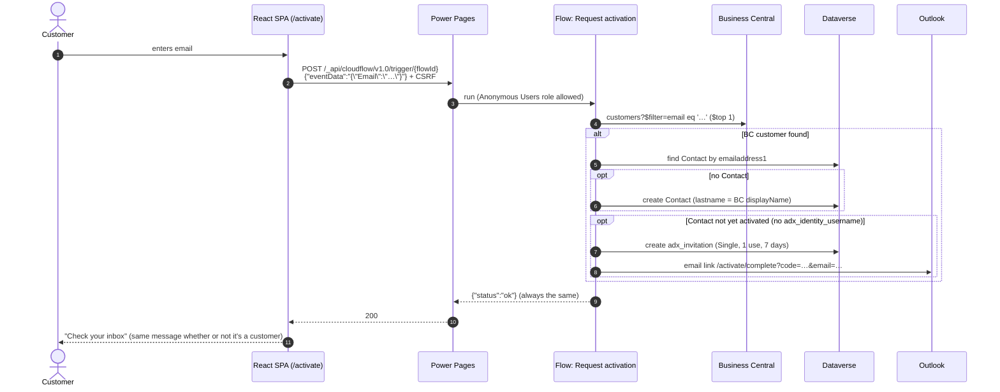
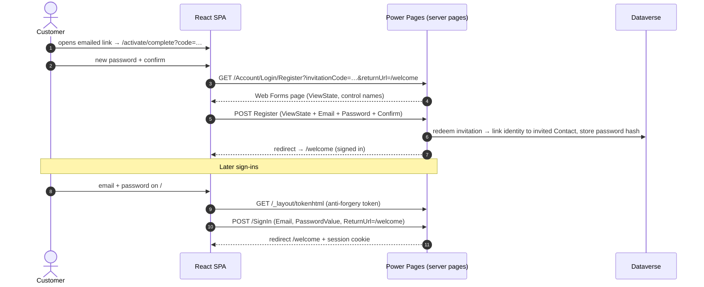

# Concreat Hub — Registration & Activation Architecture

**Source:** POC `custom-login` (Sept 28–30, 2026), tested end to end on *Development Test - MT* against BC *SANDBOXUS · My Company*.
**Purpose:** Record what the POC built and learned, so the full Concreat Hub project can rebuild it without repeating the discovery work. See `Concreat_Hub_Architecture.md` §3 for how it fits the full portal, and `Concreat_Hub_Implementation_Plan.md` (tasks S1-02, S1-03) for the production changes.

---

## 1. What it does

A customer can only get a portal login if their email exists on a **Business Central customer**. BC is the source of truth. Power Pages stores the password (hashed) on the customer's **Dataverse Contact** using its built-in local authentication.

| Screen (route) | Purpose |
|---|---|
| **Sign in** (`/`) | Email + password → Power Pages local sign-in → `/welcome` |
| **Activate your account** (`/activate`) | Customer enters email → cloud flow checks BC → emails a one-time activation link |
| **Set your password** (`/activate/complete?code=…&email=…`) | Opened from the email; redeems the invitation and sets the password |
| **Welcome** (`/welcome`) | Signed-in landing page (becomes the Dashboard in the full project) |
| Forgot password | Links to Power Pages' built-in `/Account/Login/ForgotPassword` page |

---

## 2. Flow diagrams

### Activation

### Set password and sign in

---

## 3. Security properties (why it's built this way)

| Property | How |
|---|---|
| Only BC customers can register | `OpenRegistrationEnabled = false` + `InvitationEnabled = true`, so registration is only possible with an invitation, and only the flow creates invitations, after a BC match |
| Proof of email ownership | The password is set only through a link sent **to the BC email address**, so knowing someone's email isn't enough to take over their account |
| No customer enumeration | The flow always returns `{"status":"ok"}` and the page always shows the same "Check your inbox" message |
| Single-use, expiring links | Invitation `adx_maximumredemptions = 1`, `adx_expirydate = +7 days`, random 32-hex code |
| No double activation | If the Contact already has `adx_identity_username`, no new invitation is created |
| OData injection safe | The email is lower-cased and trimmed, with single quotes doubled, before going into `$filter` |
| Passwords never touch our code | Power Pages hashes and stores them; the SPA only posts to Power Pages' own endpoints |
| CSRF | Every POST carries the token from `/_layout/tokenhtml` |

---

## 4. Components

### 4.1 React code site (Vite + React 19 + Tailwind v4 + Lucide)

| File | Role |
|---|---|
| `src/services/auth.ts` | `login()` → POST `/SignIn` (fields `Email`, **`PasswordValue`**, `ReturnUrl`); `activate()` → fetches the Web Forms Register page, copies ViewState/control names, posts back; `logout()`; `getCurrentUser()` from `window.Microsoft.Dynamic365.Portal.User`; **localhost mock session** |
| `src/services/activation.ts` | `requestActivation(email)` → POST `/_api/cloudflow/v1.0/trigger/{flowId}` with headers `__RequestVerificationToken` + `X-Requested-With: XMLHttpRequest`, body `{"eventData": "{\"Email\":\"…\"}"}` |
| `src/pages/SignIn.tsx`, `Activate.tsx`, `SetPassword.tsx`, `Welcome.tsx` | Screens (mockup-matched sign-in card) |
| `src/components/AuthCard.tsx`, `PasswordField.tsx`, `FormError.tsx` | Shared UI |
| `src/styles/theme.css` | Tailwind v4 `@theme` tokens (navy `#1B2A5E`, IBM Plex Sans). `@import "tailwindcss" source("..")` limits scanning to `src/` |

### 4.2 Site settings (`.powerpages-site/site-settings/`)

| Setting | Value | Why |
|---|---|---|
| `Authentication/Registration/LocalLoginEnabled` | true | Email/password sign-in |
| `Authentication/Registration/LocalLoginByEmail` | **true** | Sign in with email (the SPA sends the `Email` field) |
| `Authentication/Registration/Enabled` | true | Registration pipeline on (needed for invitation redemption) |
| `Authentication/Registration/OpenRegistrationEnabled` | **false** | Nobody can self-register without an invitation |
| `Authentication/Registration/InvitationEnabled` | true | Invitation redemption |
| `Authentication/Registration/ProfileRedirectEnabled` | **false** | Otherwise users land on `/profile` instead of `/welcome` |
| `Authentication/Registration/EmailConfirmationEnabled` | false | The invitation link already proves email ownership |
| `Authentication/Registration/ResetPasswordEnabled` | true | Forgot-password flow |
| `Authentication/Registration/CaptchaEnabled`, `…/IsCaptchaEnabledForRegistration` | false | The SPA can't render the server CAPTCHA widget |

### 4.3 Code-Site-Shell-Header web template

`pac pages upload-code-site` wipes the default **Header** template on every upload, so the POC adds a separate template, `Code-Site-Shell-Header`, and points `website.yml → headerwebtemplateid` at it. Its script redirects stray server-rendered auth pages back into the SPA:

| Server path | → SPA route |
|---|---|
| `/account/login/redeeminvitation?invitation=X` | `/activate/complete?code=X` |
| `/account/login/register?invitationCode=X` | `/activate/complete?code=X` |
| `/register` | `/activate` |
| `/signin` | `/` |

### 4.4 Cloud flow: "Concreat Hub - Request activation"

- **Trigger:** *When Power Pages calls a flow* (`type: Request`, `kind: PowerPages`), with one text input titled **`Email`**. The site's `eventData` key must match that title exactly.
- **Steps:** `Email` (toLower/trim) → `Email_OData_Literal` (escape `'`) → **Find_BC_Customer** (BC connector *Find records (V3)*, `customers`, `$filter email eq …`, `$top 1`) → if found: find/create Contact → if not yet activated: generate code (`replace(guid(),'-','')`) → **Create_Invitation** → **Send_Activation_Email** → **Return to Power Pages** `{"status":"ok"}`.
- **Invitation row** (`adx_invitations`): `adx_name`, `adx_type = 756150000` (Single), `adx_invitationcode`, `adx_maximumredemptions = 1`, `adx_expirydate = utcNow()+7d`, `adx_inviteContact@odata.bind = /contacts(id)`, `mspp_websiteid@odata.bind = /powerpagesites(websiteId)`. The site uses the **enhanced data model**, so the website lookup targets `powerpagesites`.
- **Contact created by the flow:** `lastname` = BC displayName, `emailaddress1`, `description` = "Business Central customer {no}".
- **Registration on the site:** `.powerpages-site/cloud-flow-consumer/*.cloudflowconsumer.yml`, web role **Anonymous Users**, `flowapiurl: /_api/cloudflow/v1.0/trigger/{workflowid}`.
- **Connections:** Business Central, Dataverse, Office 365 Outlook (sender: developer mailbox in the POC).

---

## 5. Lessons learned (save these hours next time)

| # | Issue | Fix |
|---|---|---|
| 1 | First deploy failed: `.js` attachments blocked | Remove only `js` from the environment's `blockedattachments` (admin-approved change) |
| 2 | Live site redirected to Microsoft sign-in | New sites are **private**. Test while signed in to the org; switch to Public at go-live |
| 3 | "When Power Pages calls a flow" isn't in the trigger list under *My flows → New* | Create the flow from **Power Pages → Set up → Cloud flows → + Create new flow**, or inside a **solution**; only solution-aware flows can attach to a site. Or *Save As* an existing one |
| 4 | Flow save failed: missing required `rpn_quickbooksid` | This environment's Contact has **Business Required** custom columns from another project (`rpn_quickbooksid`, `rpn_vendordisplayname`). Pass them as empty values; the Dataverse API doesn't enforce Business Required |
| 5 | The flow can't be test-run from Power Automate with inputs | Power Pages triggers only accept input when the site calls them. Test through the site |
| 6 | `eventData` key mismatch → empty input | The key must equal the trigger input's **title** (`Email`) |
| 7 | Plugin scripts said "Azure CLI token not available" on Windows | The scripts call `az` without a shell; `az` is `az.cmd` on Windows. Run them with a preload shim that maps `az` → `az.cmd` |
| 8 | `flowapiurl` became `C:/Program Files/Git/_api/…` | Git Bash rewrites arguments starting with `/`. Fix the YAML, or pass the arg from PowerShell |
| 9 | Vite served deleted scaffold files after a big refactor | Stop the old Vite process (port 5173) and restart |
| 10 | CSS bundle grew from unrelated HTML in `docs/`, `.powerpages-site/` | Tailwind v4 `source("..")` to scan `src/` only |
| 11 | Server Logic status | **GA since Apr 6, 2026**. Earlier plugin text calling it "preview" is outdated |

---

## 6. Carry into the full project (porting checklist)

**Copy as-is:** `auth.ts`, `activation.ts`, the four auth pages, `AuthCard`/`PasswordField`/`FormError`, the site settings in §4.2, the Code-Site-Shell-Header template and the `website.yml` pointer, and the `.cloudflowconsumer.yml` (after recreating the flow in the new solution).

**Change for production** (tracked as S1-02/S1-03 in the implementation plan):

| POC | Production |
|---|---|
| BC standard API `v2.0/customers`, SANDBOXUS, one company | BC team's Concreat Hub customer/contact API against **Solid Cement only** for now (see §7), with the company ID in an environment variable |
| Match on `customer.email` | BC package rule: *Customer whose registered Contact has this email* |
| Contact only | Also find/create the Dataverse **Account** (`cr_bccustomerno`, `cr_bccompanyid`, `cr_bccompanyname`), set `parentcustomerid`, create the **Account Link** row |
| No business role on activation | Per decision D4: CHP ops assigns a role (or auto-grant for the primary email) |
| Email link hardcoded to `site-hdiqg.powerappsportals.com` | Site URL from an environment variable |
| Sent from the developer mailbox | Shared mailbox (`noreply@…`) with Send As |
| Flow outside any named solution | Inside the Concreat Hub solution with **connection references**, promoted by pipeline |
| Welcome page | Replaced by the Dashboard |
| No check on BC `blocked` | Skip customers blocked in BC (confirm the rule with CHP) |
| Exact-case email match | Confirm BC's filter case behavior, or have the BC API match case-insensitively |

---

## 7. BC company scope and the duplicate-email rule

**Current decision (Oct 1, 2026): activation and the portal use one BC company, Solid Cement.** APO Cement is out of scope until confirmed.

- The packages put both companies in Release 1 scope (*"separate login email per account, of either kind"*), but the project is starting with **Solid Cement only**. Confirm the APO Cement go-live timing with Rene and the BC team.
- Keep the design **company-aware** so adding APO Cement later is configuration, not a rebuild:
  - the activation flow reads the BC company ID from an **environment variable** (`Solid Cement` company ID for now), not a hardcoded value;
  - the Account record still stores `cr_bccompanyid` / `cr_bccompanyname`, and every Server Logic call takes the company from the Account.
- **Enabling APO Cement later** (plan task S1-12): add its company ID, change the flow to search both companies, and apply the duplicate-email rule below.

**Open question Q10: an email registered on more than one BC customer**

The Nov 15 rule is one login email per account; the account switcher comes in Phase 2. An email can still match more than one customer:
- **Within Solid Cement now:** the same email on two Solid Cement customers (for example, two branches).
- **Across companies later:** the same email on a Solid Cement and an APO Cement customer.

| Option | Behavior | Notes |
|---|---|---|
| **A. Block (recommended)** | Don't create an invitation. The page still shows the neutral "Check your inbox" message; the flow emails the address telling the customer to contact the Customer Service Center, and alerts the service center | No silent wrong-account access; keeps the "one email per account" rule visible |
| B. Use the first match | Activate against the first customer BC returns | What the POC does today (`$top 1`). Order isn't guaranteed, so a customer could land in the wrong account |
| C. Pick a primary | Activate against the customer flagged as primary (needs a BC field or rule) | Needs BC work; becomes moot when the Phase 2 switcher ships |

To implement A, query BC with `$top 2` and treat more than one result as "duplicate". The same rule applies once APO Cement is added and both companies are searched.

**Owner:** Rene (business rule) + BC team (whether a "primary" signal exists). **Needed by:** S1-03.
